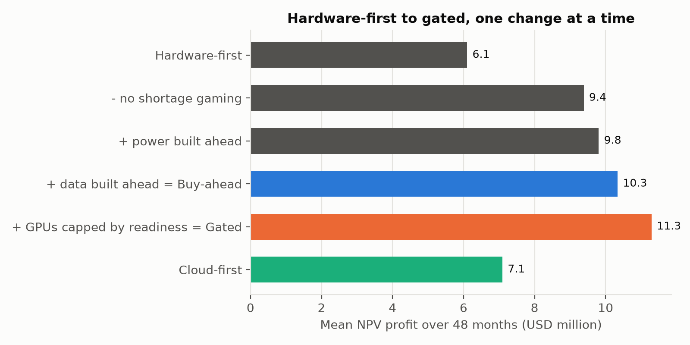

# Simulation results

Source: [baseline_table.csv](../out/baseline_table.csv), generated by [experiments.py](../experiments.py). Dollar amounts below are mean discounted profit (NPV). “GPU equivalents” are the model's units, not physical orders made by any of the cited companies.

| Policy | Mean NPV | Fleet utilization | GPUs purchased | Peak excess capacity | Demand served |
|---|---:|---:|---:|---:|---:|
| Hardware-first | $6.10M | 54.8% | 492.6 | 284.2 | 89.5% |
| Buy-ahead | $10.34M | 68.7% | 370.3 | 160.3 | 94.5% |
| Gated | $11.29M | 82.2% | 333.5 | 115.4 | 93.6% |
| Cloud-first | $7.10M | — | 0 | — | 75.0% |

The baseline favors gating on profit and utilization, but buy-ahead serves slightly more demand. Relative to hardware-first, the gated policy reduces modeled emissions attributed to waste from 1,322 to 481 tonnes of CO₂e (about 64%). Cloud-first owns no fleet, so fleet utilization does not apply.

**Why does the baseline improve?** In the decomposition, removing shortage order inflation makes the largest single change in mean NPV. Building power and data ahead helps further. Capping orders to expected readiness cuts excess GPU capacity relative to buy-ahead, even though the quarter-to-quarter order-variance ratio rises from 2.089 to 3.098. Smaller excess capacity and smoother ordering are separate outcomes.

## Figure guide

| Plot | What to look for |
|---|---|
| [1 · Example path](../out/fig1_example_path.png) | When demand, ready data, power and installed GPUs diverge in one scenario. |
| [2 · Policy decomposition](../out/fig2_decomposition.png) | Which change contributes most to the modeled improvement. |
| [3 · Fleet use](../out/fig3_fleet_use.png) | How much owned capacity is used, powered but idle, or unpowered. |
| [4 · Bullwhip](../out/fig4_bullwhip.png) | How excess buying and capacity respond to shortage risk. |
| [5 · Compute value vs. shortage risk](../out/fig5_winner_value_vs_shortage.png) | Where the most profitable policy changes as compute becomes more valuable or supply less reliable. |
| [6 · Cloud capacity vs. shortage risk](../out/fig6_winner_cloudcap_vs_shortage.png) | Where cloud scarcity affects the comparison. |
| [7 · Gated advantage](../out/fig7_gated_advantage.png) | How the effect of gating varies with data readiness speed for three compute values. |
| [8 · Carbon](../out/fig8_carbon.png) | Modeled operating, embodied and wasted emissions. |

Buying ahead can beat gating when missed compute is valuable, shortages are frequent, and cloud alternatives are scarce. Treat the boundaries in the maps as outcomes of the chosen inputs. The policies are rules rather than optimized strategies, and no parameters were learned from firm-level procurement data.

The code was rerun for this package: all eight sanity checks passed, the baseline CSV cells matched the archived results, and all eight plots regenerated. The original exported figures are retained; rendering may vary by Matplotlib version and installed fonts.
